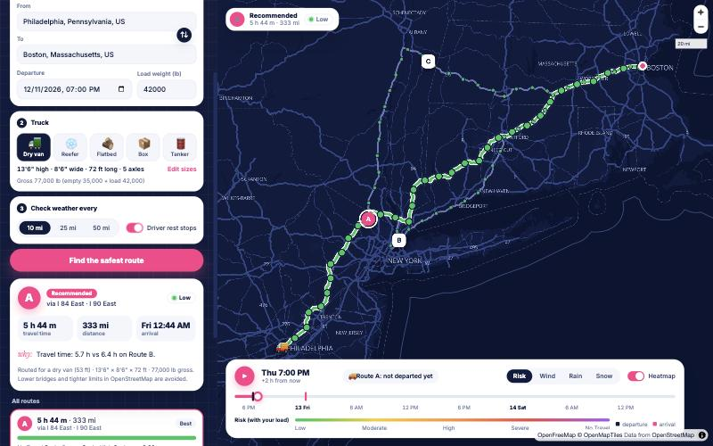

# Weather-Aware Truck Routing

A React + Django app that helps a truck driver pick the safest route. You enter origin, destination, departure time, load weight and the truck type (dry van, reefer, flatbed, box truck or hazmat tanker, with editable height, width, length and axles). The app finds 3 truck routes, reads the weather at each checkpoint **for the hour the truck gets there**, scores the risk with the brief's wind/rain/snow and load rules, and recommends a route. Everything is drawn on a map, with a weather heatmap along the corridor and a 0–48 hour forecast slider.

- **Live app:** https://weather-truck-routing-tan.vercel.app


- **Stack:** Django 5 + Django REST Framework (API), React 19 + TypeScript + Vite (UI), MapLibre GL (map), navy, white and hot-pink design
- **Try it:** the example trips on the start screen (incl. a low-bridge demo in Durham, NC); ← / → move the forecast hour, space plays it
- **Free data, no API keys:** [Valhalla](https://valhalla.github.io/valhalla/) truck routing (OpenStreetMap), [Open-Meteo](https://open-meteo.com/) hourly forecasts, [Photon](https://photon.komoot.io/) place search, [OpenFreeMap](https://openfreemap.org/) base map

## How it works

```
React (form, cards, map) ──POST /api/plan──▶ Django
                                               ├─ Valhalla: 3 truck routes (weight-aware)
                                               ├─ checkpoints every 10/25/50 mi + ETA at each
                                               ├─ Open-Meteo: hourly forecast per checkpoint cell
                                               ├─ risk per checkpoint → miles per level per route
                                               └─ ranking → recommended route + reason
React ──POST /api/heatmap (route corridor)──▶ Django: grid around the routes, 49 hourly values per cell
```

1. **Routes** (`services/valhalla.py`, `services/trucks.py`): Valhalla's `truck` costing with the truck's height, width, length, axle count, hazmat flag and gross weight (empty truck + load). Valhalla avoids roads whose OpenStreetMap limits the truck breaks: low bridges (`maxheight`), `maxwidth`, `maxlength`, `maxweight`, axle-load, hazmat and "no trucks" tags. Example (a live test): under the 12'4" Gregson Street bridge in Durham, NC, a 12'0" box truck goes straight through (0.2 mi), a 13'6" dry van is routed around it (1.4 mi). The public server sometimes returns only 1–2 truck alternatives, so the app adds detours: it routes through a point to the side of the fastest route (at 1/2, 1/3, 2/3 of the way) and keeps a detour only if it shares less than 80% of its roads with the routes it already has and is at most 60% longer. The public server rejects multi-stop routes over 1,500 km, so long detours are routed as two halves and joined.
2. **Checkpoints and ETAs** (`services/checkpoints.py`): a checkpoint at mile 0, every N miles (10, 25 or 50, the user picks), and at the destination. The ETA comes from Valhalla's driving time along the route shape. With "driver rest stops" on (default), the ETA also includes the federal hours-of-service pauses: 30 minutes after 8 hours of driving, 10 hours of rest after 11. A 1,000-mile trip arrives the next day, and the weather is read for that real time.
3. **Weather** (`services/weather.py`): Open-Meteo hourly wind (mph), rain + showers (in/hr) and snowfall (in/hr). Points are snapped to a 0.1° grid (~7 mi), so the 3 routes share forecasts where they overlap; each cell is fetched once an hour for 8 days and cached. That keeps a plan under Open-Meteo's free limit of 600 locations per minute.
4. **Risk** (`services/risk.py`): each checkpoint takes the worst of wind (after the load rules), rain and snow.
5. **Ranking** (`services/ranking.py`): see below.
6. **Heatmap** (`services/heatmap.py`): a regular grid covering 40 miles around every route (finest step that keeps it under 260 cells), with 49 hourly values per cell: risk (with the load rules), wind, rain, snow.

## Decisions worth knowing

| Topic | Decision |
|---|---|
| Range edges | The brief's ranges touch ("0.10–0.25", "0.25–0.50"), so each range includes its lower bound: 0.25 in/hr rain is High, 35 mph is High. Top bands follow the brief's symbols: wind **≥**55 is No Travel, but rain exactly 1.00 and snow exactly 3.0 are still Severe (">1.00", ">3.0"). All edges are unit-tested. |
| Wind value | Sustained 10 m wind speed is scored (the brief's table is wind speed). Gusts are shown in the checkpoint popup. |
| Truck sizes | Typical US presets (dry van and reefer 13'6" × 8'6" × 72 ft, 5 axles; flatbed 11'0"; 26 ft box truck 12'0" × 8'0", 2 axles; hazmat tanker 11'6"), all editable. Routing uses **gross** weight (empty + load) and warns above the 80,000 lb federal limit; the brief's weather rules use the **load** weight. |
| Load rules | ≥55 mph → No Travel for any load; 45–54 mph and >30,000 lb → No Travel; 35–44 mph and >40,000 lb → Severe. The rule that fired is shown as the reason. |
| Miles per level | Each checkpoint stands for the route miles closest to it (half the gap to each neighbour), so the miles of all checkpoints add up to the route length, at any interval. |
| Recommendation | Sorted by a key: **No Travel miles**, then the brief's order: Severe miles, High miles, average risk (mile-weighted, 0–4), travel time. No Travel comes first because the brief's list starts at Severe, but a route through No Travel weather cannot be driven, so it must never beat a route that is only Severe. Miles are rounded to 0.1 so float noise cannot decide. The UI shows which rule decided, e.g. "Severe miles: 0.0 mi vs 12.0 mi on Route B." |
| Forecast range | Departure must be within 5 days; checkpoints past the 8-day forecast are marked "No forecast" and shown as hatched miles. |
| Forecast slider | 0–48 h from now, as the brief asks: it is the heatmap's forecast over the corridor, so it does not stop at arrival. The trip is shaded on it. ▶ plays the trip from departure to arrival with one clock for truck, camera, slider and weather: 1 s per hour of driving; the 30-min break and the 10-h rest stand still and fast-forward (pink pulse). Drag past arrival to see later weather. |
| Map | The camera follows the truck while playing (drag to look around, ⌖ to come back). ⌖ turns pink when the selected route is off screen. Picking another route stops playback and starts that route from departure. |

## Performance

- The plan request and the heatmap are two calls: routes appear first (typically 3–5 s cold, instant when cached), the corridor forecast follows (~1 s).
- **Slider:** all 49 hours are sent once. Moving the slider only changes which feature property the map's colour expression reads (`r12` → `r13`); MapLibre restyles on the GPU, with no new data or React re-render of the map.
- The selected route is coloured by risk with a single `line-gradient` on the GPU, not hundreds of segments.
- The map library (most of the download) loads as its own file, so the form is usable at once; its web worker is bundled by Vite.
- Server answers from Valhalla, Photon and Open-Meteo are cached in memory.

## Run locally

Requirements: Python 3.12+, Node 20+.

```bash
python3 -m venv .venv && . .venv/bin/activate
pip install -r requirements-dev.txt
cd backend && python manage.py runserver 8000      # API on :8000
```

```bash
cd frontend && npm install && npm run dev          # UI on :5173, proxies /api to :8000
```

Tests (risk bands, load rules, checkpoints, ETAs with rest stops, ranking, truck sizes):

```bash
cd backend && python -m pytest
LIVE_TESTS=1 python -m pytest -k live   # also checks the low-bridge example against the public Valhalla server
```

## Deploy

One Vercel project: the Vite build is served as static files and `api/index.py` runs Django as a Python function (`vercel.json`). No environment variables are required; `VALHALLA_URL`, `OPEN_METEO_URL` and `PHOTON_URL` can point to self-hosted services.

## Limits

- Free public services have rate limits; a self-hosted Valhalla would remove the detour workaround and the 1,500 km limit.
- Hours of service: the 14-hour duty window and the 70-hour/8-day cycle are not modelled.
- Forecast resolution is about 3–10 km; the 0.1° grid matches that.
